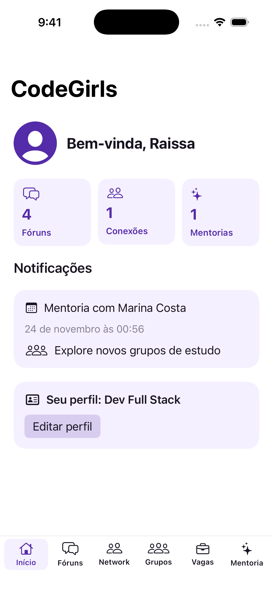
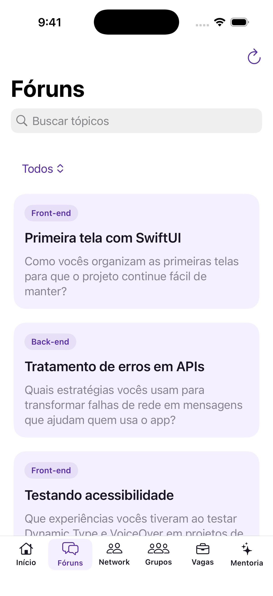
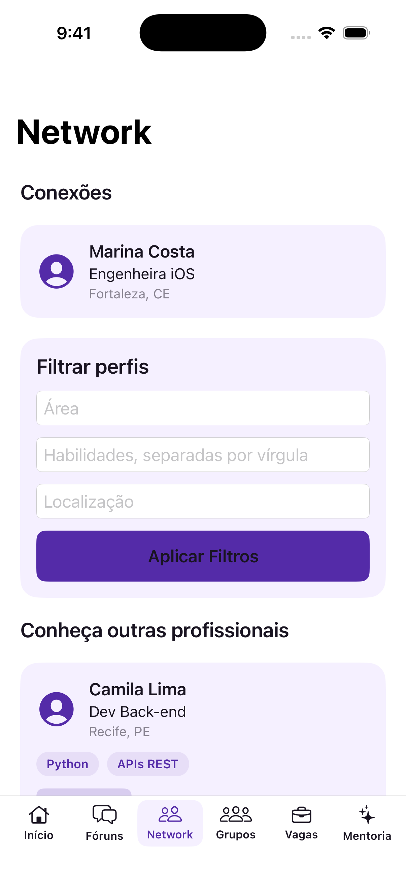
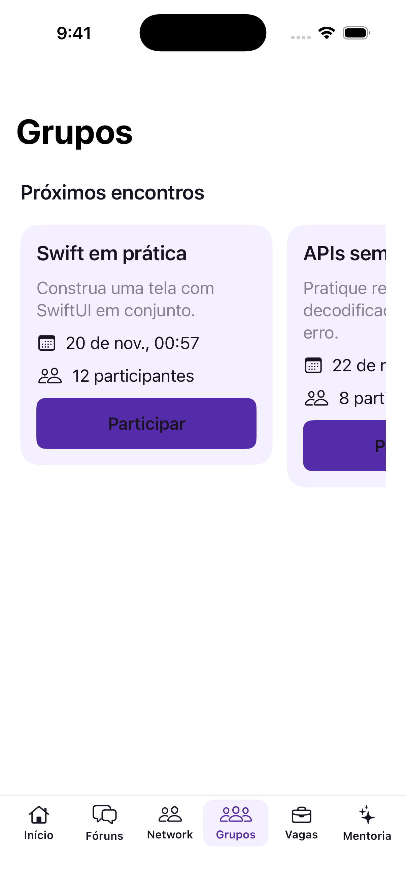
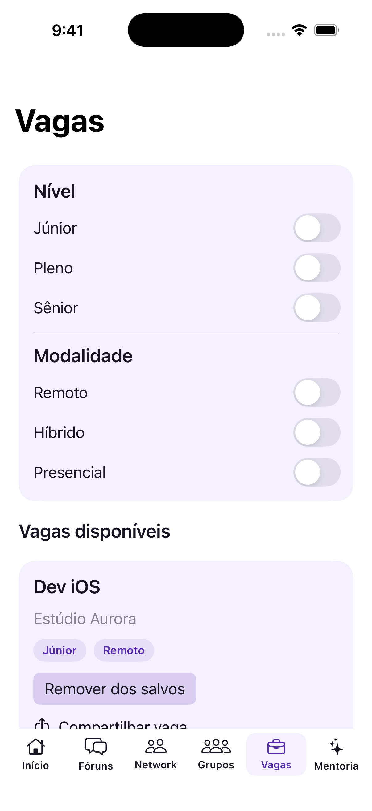
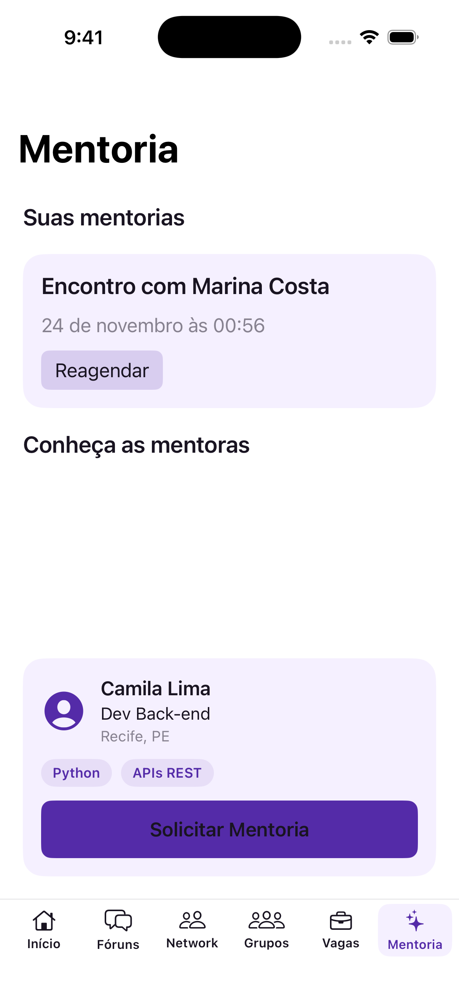

# CodeGirls

CodeGirls é um protótipo iOS de uma rede de apoio para mulheres em tecnologia. A proposta é reduzir o isolamento e fortalecer o pertencimento por meio de fóruns, conexões profissionais, grupos de estudo, vagas e mentorias.

## Motivação e evolução técnica

Fiquei em **1º lugar na lista de espera da seleção anterior da Apple Developer Academy**. Usei esse tempo para me aperfeiçoar tecnicamente em Swift, arquitetura MVVM, persistência de dados e consumo de APIs assíncronas, para retornar ainda mais preparada. Desenvolvi o CodeGirls para aplicar esse aprendizado a um problema que me motiva: criar espaços em que mulheres em T.I. encontrem apoio, referências profissionais e oportunidades de colaboração.

## Funcionalidades

| Aba | O que você pode fazer |
| --- | --- |
| Início | Editar o nome e a foto de perfil, acompanhar as estatísticas da comunidade e conferir o próximo encontro de mentoria. |
| Fóruns | Carregar os tópicos pela API de demonstração, pesquisar por texto, filtrar por categoria atualizar o feed e repetir a requisição em caso de falha. |
| Network | Filtrar sugestões por área, habilidades e localização, adicionar conexões, ver o contador atualizar e limpar filtros. |
| Grupos | Percorrer os próximos encontros na horizontal, conferir data e participantes, entrar em um grupo ou sair dele. |
| Vagas | Combinar filtros de nível e modalidade salvar oportunidades em uma seção própria e compartilhar vagas pelo menu do sistema. |
| Mentoria | Conhecer as especialidades das mentoras, simular uma solicitação e reagendar um encontro com o seletor nativo de data e hora. |

Os perfis, as vagas, os grupos e os encontros são demonstrativos. Conexões, participações e solicitações são interações locais do protótipo. A navegação e os controles são em SwiftUI, com uma barra inferior de seis destinos. A foto é escolhida pelo seletor nativo do sistema.

## Arquitetura e requisitos técnicos

- **MVVM** — Os modelos `User`, `ForumTopic`, `Mentorship`, `StudyGroup` e `JobOpening` conformam a `Identifiable` e `Codable`. A `CodeGirlsViewModel` mantém o estado do app, aplica filtros e valida ações. As Views observam o estado e encaminham as interações.
- **URLSession e async/await** — A ViewModel faz um GET em `/posts` do [JSONPlaceholder](https://jsonplaceholder.typicode.com/), valida a resposta HTTP e usa os IDs decodificados para selecionar tópicos fictícios em português. A tela exibe carregamento, sucesso, resultado vazio e erro com opção de tentar novamente.
- **AppStorage** — O nome começa como `Raissa`. O nome editado, a miniatura de perfil, o contador, os IDs das conexões as vagas salvas, as participações em grupos e as datas das mentorias persistem no dispositivo.
- **Arquivo único** — [CodeGirls.swift](CodeGirls.swift) reúne os modelos, a ViewModel, as Views e o ponto de entrada `@main`. Os comentários em português descrevem as responsabilidades de cada camada.

## Como executar

O código usa APIs disponíveis a partir do iOS e iPadOS 16. A versão do Swift Playgrounds instalada pode exigir uma versão mais recente do sistema. O feed de Fóruns precisa de internet.

### iPad

1. Abra o [Swift Playgrounds para iPad](https://support.apple.com/en-lamr/guide/playgrounds-ipad/welcome/ipados) e crie um projeto do tipo **App**, com o nome **CodeGirls**.
2. Abra o arquivo Swift que já contém `@main` e substitua todo o conteúdo pelo de [CodeGirls.swift](CodeGirls.swift).
3. Remova o arquivo de tela gerado pelo modelo, geralmente `ContentView.swift`. O projeto deve ter um único `@main`.
4. Toque em **Executar**. Abra **Fóruns** para conferir os tópicos e **Início** para editar o perfil.

### iPhone

Crie um projeto iOS do tipo **App** com interface SwiftUI no Xcode para macOS, ou abra o projeto do iPad no Xcode. Use o mesmo arquivo como único ponto de entrada. Selecione um simulador ou um iPhone configurado para desenvolvimento, então execute o app. O ambiente de autoria do Swift Playgrounds está disponível para [iPad e Mac](https://developer.apple.com/documentation/swift-playgrounds).

## Roteiro de demonstração

1. Altere o nome e selecione uma foto em **Início**. Feche e reabra o app para verificar o perfil.
2. Em **Fóruns**, selecione **Back-end** e busque por `API`. Sem conexão, abra o app novamente e use **Tentar novamente** após recuperar o acesso à internet.
3. Em **Network**, filtre por `Back-end` e conecte-se com Camila. Confira o contador em **Início**.
4. Em **Grupos**, participe de um encontro e observe a atualização na contagem.
5. Em **Vagas**, selecione **Pleno** e **Híbrido**, salve uma vaga e confira **Vagas salvas**.
6. Em **Mentoria**, solicite um encontro com uma mentora disponível e altere o horário em **Suas mentorias**.
7. Feche e reabra o app. Confirme a participação em **Grupos** e o horário salvo em **Mentoria**.

## Capturas de tela

Crie a pasta `docs/screenshots` no repositório. Capture cada aba com o app em execução e salve os PNGs nos caminhos abaixo para exibi-los no GitHub.

| Início | Fóruns | Network |
| --- | --- | --- |
|  |  |  |

| Grupos | Vagas | Mentoria |
| --- | --- | --- |
|  |  |  |

## Autoria

Desenvolvido por **Raissa Reis** como projeto de portfólio.
